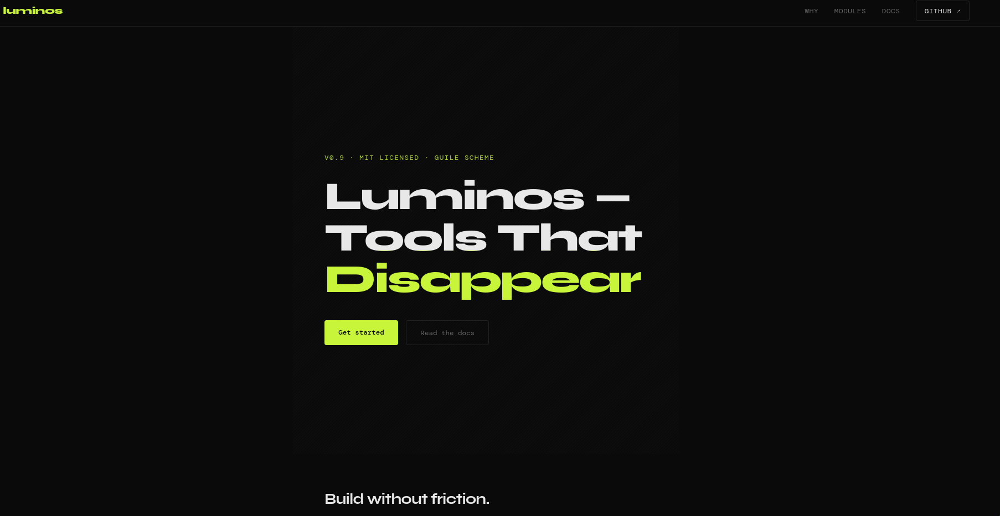

#+title: Haunt Example: Landing Page

A minimal example of a single-page landing site built with [[https://dthompson.us/projects/haunt.html][Haunt]], the
[[https://www.gnu.org/software/guile/][Guile Scheme]] static site generator.

* Project layout

#+begin_example
haunt-landing-page/
├── haunt.scm           <= site configuration & template
├── pages/
│   └── index.md        <= landing page content (Markdown)
└── assets/
    └── css/
        └── style.css   <= stylesheet (copied verbatim)
#+end_example

* How it works

- =pages/index.md= is a *flat page*: a Markdown file with a metadata
   header understood by Haunt:

#+begin_example
title: My Page Title
---

# Markdown content starts here
#+end_example
   
- =haunt.scm= wires everything together:
   - =(commonmark-reader)= parses the =.md= files
   - =(flat-pages "pages" #:template landing-layout)= converts each
     file in =pages/= to an HTML page at the same path in =site/=
   - =(static-directory "assets")= copies CSS/images unchanged
   - =landing-layout= is a plain Scheme procedure that returns SXML;
     its signature =(site title body)= matches what =flat-pages= expects

* Requirements

- [[https://www.gnu.org/software/guile/][GNU/Guile]] (>= 3.0)
- [[https://dthompson.us/projects/haunt.html][Haunt]] (>= 0.3; can install with =guix install haunt= or build from source)

* Usage

#+begin_src bash
# Build the site
haunt build

# Serve with live reload at http://localhost:8080
haunt serve --watch
#+end_src

The generated =site/= directory contains plain HTML/CSS and can be
deployed to any static host (Sourcehut Pages, Netlify, Codeberg Pages,
a VPS running nginx, etc.).

* Customisation

- *Content*: edit =pages/index.md=: add sections, change copy, add new
  =.md= files for additional pages
- *Layout*: edit the =landing-layout= procedure in =haunt.scm=;
  it returns SXML so you have the full power of Scheme for templating
- *Styles*: edit =assets/css/style.css=
- *Multiple pages*: drop more =.md= files into =pages/=; each gets its own
  URL automatically
